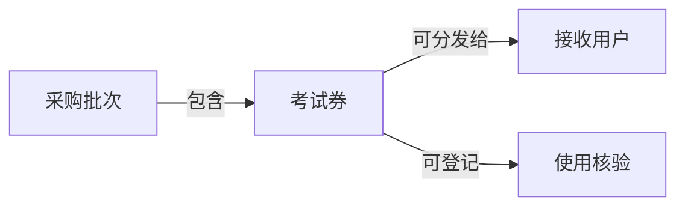
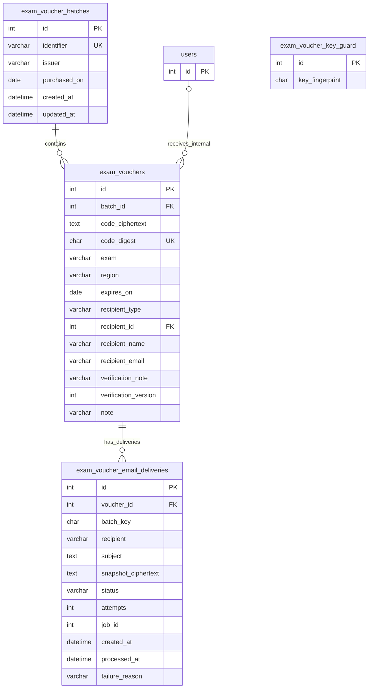

# 考试券管理模块

## 业务需求

考试券模块供获授权的内部人员维护采购批次、导入和查询考试券、登记内部学员或外部用户为接收人、手动发送考试券邮件及人工核验使用情况，并查看库存和到期提醒。模块独立于约考管理，不要求先创建约考记录；学员和外部用户没有自助入口。采购审批、财务付款、自动核销及与约考记录关联不属于当前范围。业务规则见 [TeamsExam 需求说明](teams-exam.md#考试券管理模块)。

## 业务概念

| 概念或关系 | 定义 |
| --- | --- |
| 采购批次 | 用于归集所采购考试券的批次，记录批次标识、发券方和可选的采购日期 |
| 考试券 | 属于一个采购批次，可分发给一个接收人的券 |
| 接收用户 | 内部人员选择并确认的内部学员账号，或通过姓名和邮箱登记的外部用户 |
| 已分发 | 考试券已登记接收用户 |
| 已核验使用 | 内部人员依据官方预约结果及凭证登记核验；与分发状态相互独立 |

概念图展示业务含义，不代表每个概念都对应独立数据表；实际存储关系见下方实体关系图。

## 实现设计

### 模块接入

模块位于 [`admin/modules/ExamVouchers/`](../admin/modules/ExamVouchers/)，复用后台身份、权限、通知、操作审计及界面能力。业务管理路由要求 `exam-vouchers.manage` 权限；超级管理员默认获得模块权限，其他角色由“系统设置 → 角色与权限”分配。运维邮件元数据页面单独要求 `email-deliveries.view`。

模块各语言的 `Language/{locale}/Admin.php` 通过框架原生语言合并补充 `permissionDomainLabels.exam-vouchers`，使角色与权限页面显示本地化的考试券领域名称，不修改底座语言文件或权限目录描述。

采购批次新增和编辑在操作审计中记录业务动作及提交的批次标识、发券方和采购日期；考试券导入记录批次及上传文件大小；考试券分发记录 `exam-voucher.assign`、考试券 ID、接收人类型和内部 `recipient_id`，不在审计副本中保存外部姓名或邮箱。审计页面显示稳定动作标识，展开“提交内容”可查看已采集字段。提交字段反映原始请求内容，不代表实际生效值，失败请求也可能记录未经验证的值；分发是否成功须结合审计结果判断。仅采集声明的字段，不采集券码字段、外部用户的姓名和邮箱、使用核验说明和备注。批次删除、使用核验和备注继续使用基础操作审计。历史记录不回填。

侧栏“考试券管理”提供“采购批次”和“考试券列表”两个入口。内部人员可新增、查看和编辑采购批次；批次标识全局唯一，仅不含考试券的批次可以删除。批次页面和批次列表均提供考试券列表入口，导入仍从指定批次进入。列表搜索范围仅包括批次标识、发券方、适用考试和地区；从批次页面进入时可按批次缩小范围。

列表、详情及分发、核验和备注页面显示单券编号（券记录 ID），用于区分同批次中的不同考试券；编号不是券码。

列表以状态徽标区分已分发和未分发的考试券，并显示已分发券的接收人；外部接收人同时显示邮箱，详情页显示完整接收信息。

采购批次列表显示每个批次包含的考试券总数，包括已分发和已核验使用的券；空批次显示 0。

新建批次时，批次标识预填 `BATCH-000001` 形式的流水号，按现有同格式标识的最大序号递增，用户可自行修改。删除最大编号后，该编号可能再次被建议。建议值不会预留；多人同时新建可能获得相同建议值，保存时仍须通过唯一性校验，冲突时需要更换标识。

### 实体关系

下图展示模块核心表、接收人和邮件投递记录的关系；`users` 是后台现有用户表。密钥守卫独立于业务记录，没有指向考试券的外键。

每张券属于一个批次，可关联零个或一个接收人；一个接收人可接收多张券。`recipient_type` 为空表示未分发，`internal` 表示关联现有后台用户，`external` 表示通过姓名和邮箱记录外部用户。接收人类型与对应字段由数据库约束保持一致；升级时既有内部接收人会标记为 `internal`。外部邮箱不要求唯一。分发后不支持退回、转让或重新分发。数据库限制删除仍被考试券引用的批次或内部用户。

登记内部接收人时可在下拉框中输入部分用户名搜索，不区分大小写；结果显示账号头像，最多显示 20 个，超过时可继续输入以缩小范围。选择用户并确认其学员身份后才分发；选择器不可用时可使用普通搜索和选择。登记外部接收人时必须填写姓名和有效邮箱；系统只记录信息，不创建账号或发送通知。

`verification_note` 非空表示已核验使用，`verification_version` 用于并发检查；`note` 是独立备注，不影响分发或核验。密钥守卫保存密钥指纹，用于阻止更换密钥后绕过券码全局重复检查。

### CSV 导入与券码保护

选择已有采购批次，上传 UTF-8 编码的 CSV 文件，表头必须为 `code,exam,region,expires_on`。每次允许导入 1 至 500 条记录，文件最大为 1 MB。`code` 和 `expires_on` 必填；`exam` 和 `region` 可留空。日期格式为 `YYYY-MM-DD`。系统去除字段首尾空白；券码区分大小写，去除首尾空白后须全局唯一。任一行无效时，整个文件均不导入，并报告错误行及原因。

券码密文使用框架加密器生成；系统使用经过域分离的带密钥摘要保证券码唯一，不存储明文。普通列表不会读取券码密文或摘要；获授权的内部人员可以打开单张券的详情以解密券码。详情响应标记为 `no-store`；解密失败时返回错误，日志仅记录券 ID 和异常类型。详情使用独立视图渲染器，避免调试工具栏的共享视图数据保留券码。

### 库存、核验与备注

库存概览统计全部考试券，不受列表搜索、批次筛选和分页影响。未分发与已分发数量互斥；已核验使用是独立维度，可能与任一分发数量重叠。

使用核验是依据官方预约结果及凭证进行的人工登记，不代表已参加考试或考试通过。内部人员填写简短依据说明，最多 255 字符，不填写券码或上传凭证。可以更正说明或撤销核验；撤销时会清除说明。列表显示是否已核验使用。保存时使用版本检查，避免旧表单覆盖其他人的修改；不要求券已分发或未过期。

每张券可填写一条可编辑的单行备注，最多 255 字符；清空内容即可删除备注。备注可记录过期或作废情况，但不会改变状态、分发、核验或库存。核验和备注写入使用现有基础操作审计，不采集提交字段。

### 接收人邮件

内部人员在列表中选择已分发的券并确认发送；跨页选择保存在当前浏览器会话。已发送过的券需再次确认；排队或发送中的券不能重复提交。逐项校验失败时整批不入队。每次发送使用提交时的模板和接收人，生成独立投递记录；手动重发使用当前模板及接收人并创建新记录。发送结果按批次查看，自动重试次数计入原记录。

业务模板由具备考试券管理权限的人员维护，与系统邮件模板分开。正文支持 `{name}`、`{code}`、`{exam}`、`{region}` 和 `{expiresOn}`，必须包含 `{code}`；主题不支持变量。业务人员可查看记录和重发，拥有系统邮件记录查看权限的运维人员可查看收件人、主题和状态等元数据，但不能查看正文或重发。

每张券的正文快照加密保存，队列载荷只包含投递记录编号；投递完成或最终失败后清除快照。邮件失败记录和应用日志不记录正文、券码或传输服务返回的原始错误。邮件接收人的邮箱仍会保留明文券码，应按兑换凭证管理。发送成功表示邮件服务已接受，不保证进入收件箱；若服务接受邮件后进程在记录成功前中断，自动重试可能导致重复投递。

发送失败复用底座 `QueuedEmail::auditFailureReason()`，仅保存 SMTP 拒绝、认证失败、连接或 TLS 故障等安全分类摘要；快照解密或解析失败单独记录为 `Email snapshot could not be decoded.`。最终失败保留最后一次分类原因，重试成功后清除原因；不改写既有失败记录，也不将考试券投递写入系统邮件记录表。

### 到期提醒

考试券模块通过 [`Config/Registrar.php`](../admin/modules/ExamVouchers/Config/Registrar.php) 的 `Tasks()` 声明任务，由底座统一聚合，在应用时区每天午夜调度 `exam-voucher-expiry`，同时保留现有 `send-email` 任务。无需模块或应用级 `Config/Tasks.php`，也不依赖模块自动加载顺序。接入约定见[模块开发与底座扩展](module-development.md)。提供的配置默认为 UTC；无论应用使用哪个时区，该命令始终按 UTC 日期计算。

提醒窗口从到期日前一个自然月开始，包含到期日；如果上个月较短，则起始日取该月最后一天。延迟导入或漏跑的任务会在仍处于窗口内时补发。每张券向当前持有 `exam-vouchers.manage` 权限的每个未删除用户发送一条站内通知，包括通过用户组获得权限的用户。分发、核验和备注情况不会使券被排除。投递使用现有通知唯一约束，因此重试和并发执行不会产生重复通知。通知不包含券码，链接指向受权限保护的列表；权限撤销后通知也会被隐藏。不发送邮件。

## 运行约束

部署时必须为 CodeIgniter 配置安全生成且稳定的 `encryption.key`，长度至少为 32 字节，并安全备份密钥。详情解密使用的密钥必须与导入时一致。不要在未同步处理已存储考试券的情况下单独更改密钥：轮换时须先通过迁移协调完成重新加密、摘要重算及密钥守卫更新，然后才能恢复导入。

现有 Tasks cron 须每分钟运行一次（见 [`docker/php/tasks.cron`](../docker/php/tasks.cron)）；可使用 `php spark tasks:list` 检查任务是否已注册。请监控调度器输出和应用错误日志：Tasks 会捕获命令异常并报告 `Failed: exam-voucher-expiry`，但 `tasks:run` 本身仍可能以成功状态退出。发生失败时应及时排查，并在考试券仍处于提醒窗口内时重新运行 `php spark exam-vouchers:remind-expiry`；该命令会向外抛出失败，且可以安全重试。不要仅为测试而针对生产数据库运行此命令，因为它会发送真实通知。

部署前执行 `php spark migrate --all`。`exam-voucher-email` 每分钟执行 `queue:work exam-voucher-email --stop-when-empty`，独立于系统的 `email` 消费任务。批量入队要求数据库队列使用与业务数据相同的共享连接；其他队列后端或连接不支持该事务保证。邮件发送失败时自动重试最多三次，最终失败后可在业务记录中手动重发；应监控调度器和失败记录。加密密钥在排队期间必须保持可用且不变。

模块测试位于 [`admin/tests/unit/`](../admin/tests/unit/)，运行测试时须使用 [独立测试数据库](../README.md#运行测试)，不要指向业务库。